# Culltron CivicOps

**Live demo:** https://civicops.culltron.app · **Video:** https://youtu.be/zwlLK5Exefg

**Municipal operations: one resident reference, a live control-room map, qualified crews and human approval at every dispatch.** CivicOps combines multilingual intake, bounded reasoning, staff SSO/RBAC, municipality isolation, PostgreSQL durability, verified audit and tested recovery in one control room.

**Live provider status.** The live demo runs ElevenLabs voice/text through a server-minted signed URL, and Gemini 3.5 Flash-Lite for the intake agents with Azure OpenAI as fallback. Hard spend caps on AI and voice (and provider credit exhaustion) fall back to a labelled simulation: "Spend cap reached. Simulation mode". Production approval, municipal SSO, AMD hardware runs and cluster execution remain owner-pending. [Readiness matrix](docs/ENTERPRISE_READINESS.md) · [Municipality onboarding](docs/ONBOARDING_MUNICIPALITY.md) · [Runbook](docs/operations/RUNBOOK.md) · [Dated verification](docs/VERIFICATION.md).

| | |
|---|---|
| **Live map** · wards, cases, crews and hazard zones with human-reviewed dispatch suggestions | **Crew app** · consent-based shifts, offline jobs, PWA and Android |
| **Omnichannel** · voice, SMS, WhatsApp and web into one reviewed case | **SOS** · resident and crew alerts to the control room, never replacing 10111/10177/112 |
| **Multi-agency** · utilities, Metro Police, Traffic, Fire, EMS and Disaster Management on one incident with human-decided mutual aid | **Training (VR/AR layer)** · catalogue API with hazards, PPE and certifications for training modules |
| **Enterprise** · SSO, tenancy, POPIA controls, verified audit and observability | **Responsible by design** · no face recognition, no person scoring, a human decides every dispatch ([how](docs/RESPONSIBLE_AI.md)) |

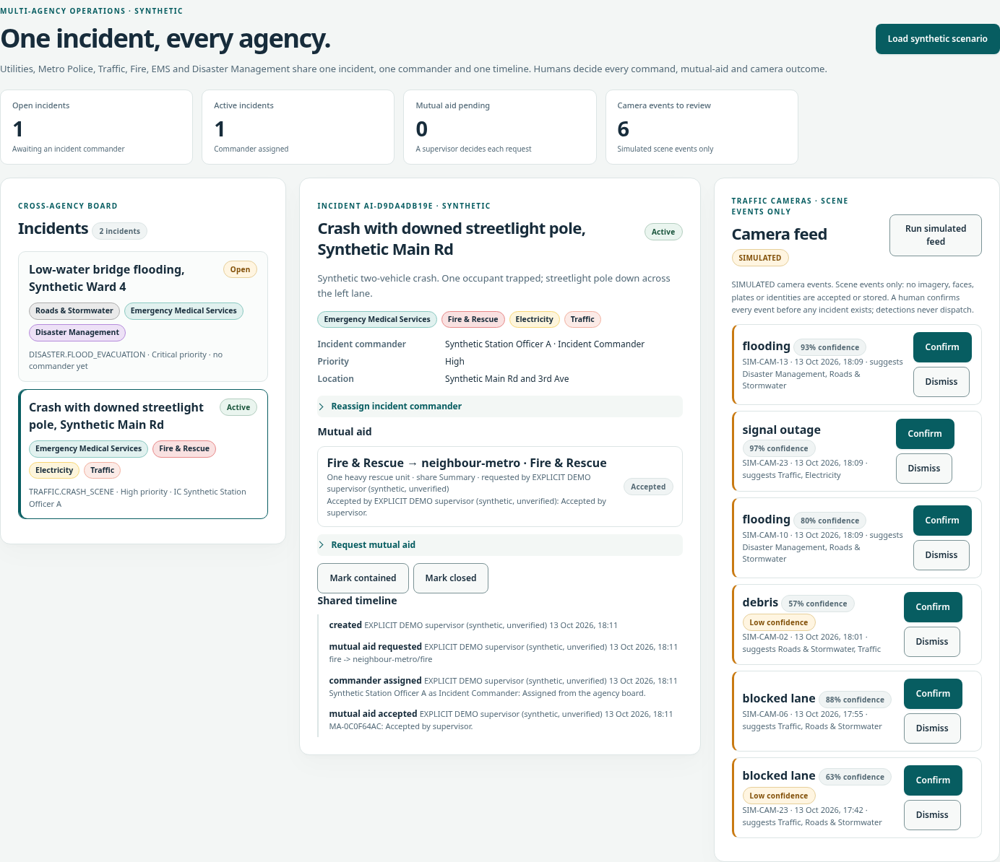

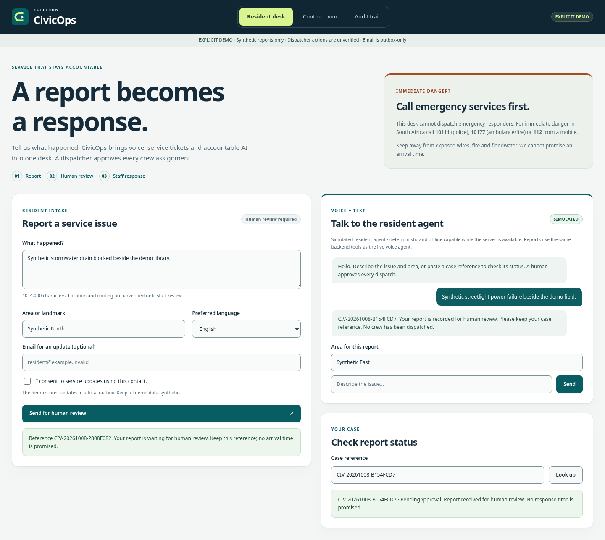

*Actual browser capture, synthetic demo data. The offline demo uses deterministic reasoning, simulated chat and provider request outboxes.*

## See the product

<table>
  <tr>
    <td width="50%" valign="top"><a href="docs/media/map-control-room.png">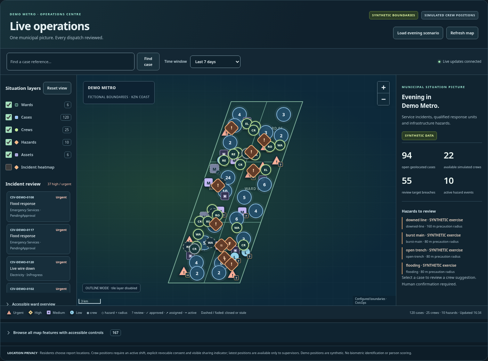</a><br><strong>Live geographic operations</strong><br>120 synthetic cases, 25 crew positions and human-reviewed dispatch suggestions.</td>
    <td width="50%" valign="top"><a href="docs/media/map-heatmap.png">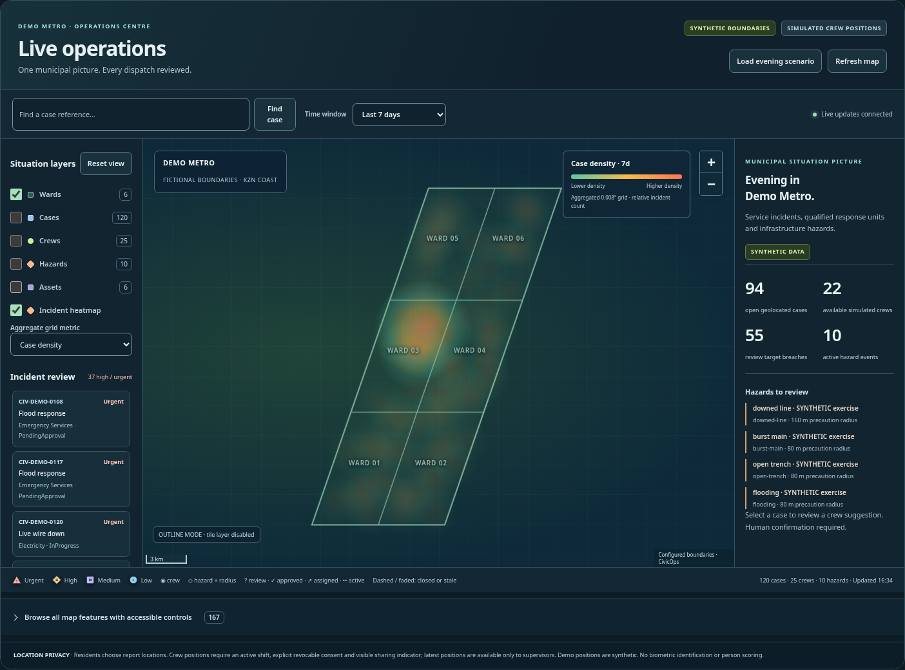</a><br><strong>Incident density, with context</strong><br>Aggregated cases or hazards, without person tracking or crime prediction.</td>
  </tr>
  <tr>
    <td width="50%" valign="top"><a href="docs/media/control-room.png">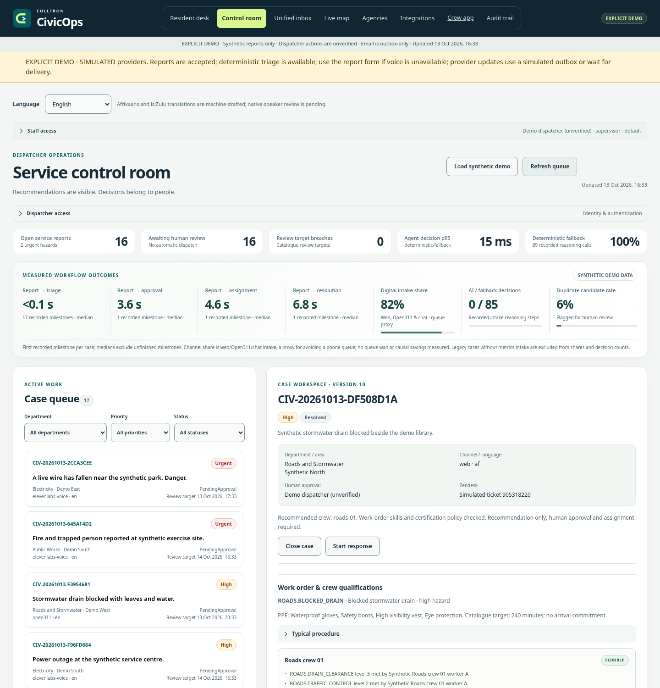</a><br><strong>One control room</strong><br>Synthetic outcome metrics, the queue and qualified crew review.</td>
    <td width="50%" valign="top"><a href="docs/media/case-timeline.png">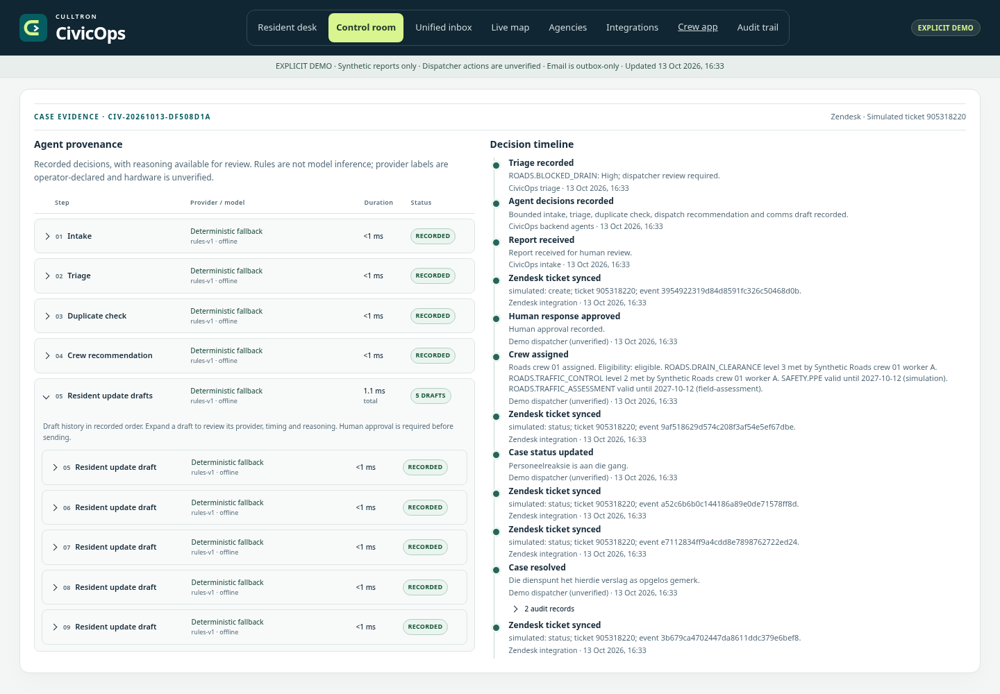</a><br><strong>Every decision has context</strong><br>Expanded capture of actual provenance and human decisions.</td>
  </tr>
  <tr>
    <td valign="top"><a href="docs/media/crew-certifications.png">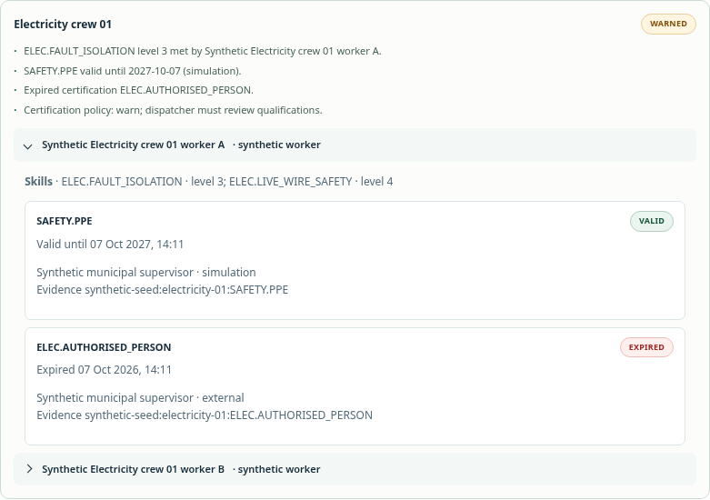</a><br><strong>Qualifications before assignment</strong><br>Scannable eligibility reasons and certificate expiry evidence.</td>
    <td valign="top"><a href="docs/media/audit-verify.png">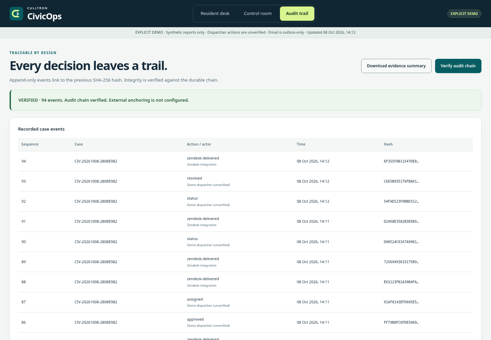</a><br><strong>Reviewable audit evidence</strong><br>Local hash-chain verification of synthetic workflow events.</td>
  </tr>
  <tr>
    <td valign="top"><a href="docs/media/simulated-agent-chat.png">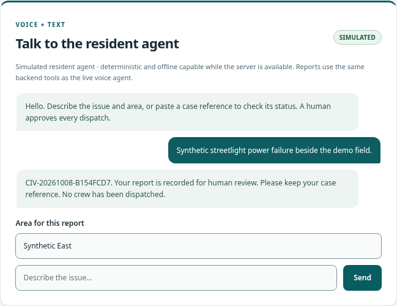</a><br><strong>A conversation, then a reference</strong><br>A full simulated resident exchange with no live provider call.</td>
    <td valign="top"><a href="docs/media/mobile-resident.png">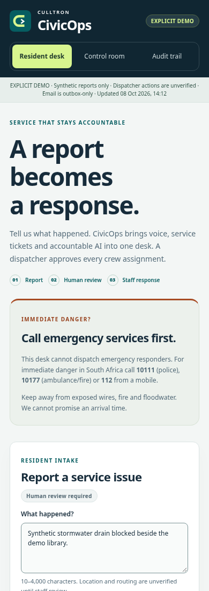</a><br><strong>Ready for a small screen</strong><br>The same synthetic resident desk at 390 pixels wide.</td>
  </tr>
</table>

The timeline capture places evidence side by side and opens the native draft-history group for readability. Every recorded run remains inspectable; the paired resolution audit records appear under one milestone. The content is the actual synthetic browser rendering.

The offline walkthrough is report → triage → case record → human approval → eligible assignment → resolution → reviewed update → verified audit. [Three-minute recording plan](docs/DEMO_SCRIPT.md).

Open **Live map → Load evening scenario** for the separate deterministic geographic exercise. Leaflet and clustering are vendored; no map key or runtime CDN is required. Set `CIVICOPS_MAP_TILE_URL=none` for an outline-only map without tile traffic. The default standard OSM tiles retain attribution and normal caching; production capacity/privacy terms require an approved tile service. [Map setup, APIs and limits](docs/MAPS.md) · [Responsible AI and location boundaries](docs/RESPONSIBLE_AI.md).

Residents report through a form, Open311, or ElevenLabs voice/text. Backend agents extract, triage, flag duplicates, recommend a crew and draft updates. Their intended inference workload runs on an open model served by vLLM/ROCm on **AMD Instinct**. **AMD hardware and performance remain unverified;** the live demo uses Gemini 3.5 Flash-Lite. ElevenLabs supplies the conversational channels when configured. An optional ticketing outbox integration exists but is not used in the demo. Humans approve responses, assign crews and approve communications; agents cannot perform those decisions.

## Run the synthetic demo

With .NET SDK 10 installed, one command runs the synthetic product:

```bash
CIVICOPS_DEMO_MODE=true dotnet run --project products/civicops --urls http://localhost:5080
```

Open [localhost:5080](http://localhost:5080) and choose **Load synthetic demo** in the control room. Missing credentials select deterministic reasoning, simulated resident chat and email outboxes. Demo forces simulated providers and the email outbox unless live providers are explicitly configured. No filled `.env` is needed; dotnet reads exported environment variables.

## Voice, SMS and WhatsApp inbox

Open **Inbox → Load synthetic channels** for signed synthetic voice, SMS and WhatsApp reports, shared case triage, per-channel conversations and human call-taker/callback queues. Staff review versioned en/af/zu templates and explicitly approve each reply; demo replies are labelled **SIMULATED**. STOP/START preferences persist across providers. The resident, crew PWA and Android clients also provide a deliberate SOS trigger that alerts the municipal control room; it never replaces 10111/10177/112 or dispatches anyone automatically. See [SOS operations](docs/SOS.md). Utilities, Metro Police, Traffic, Fire, EMS and Disaster Management share cross-agency incidents with human-decided mutual aid; see [multi-agency operations](docs/AGENCIES.md).

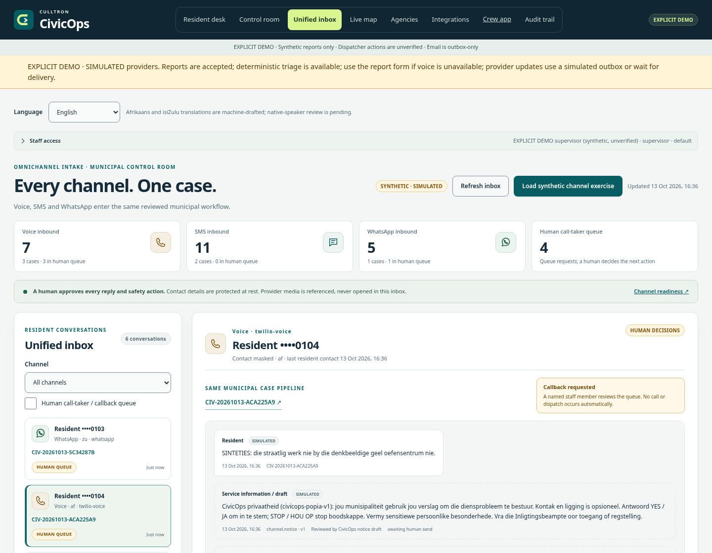

[Provider setup, native authentication, loopback relay and acceptance limits](docs/CHANNELS.md). Native adapters and configured transports have local fake-handler evidence; real calls, messages, provider playback/delivery and municipal translations remain unverified. Consent and human dispatch rules apply to every channel.

## Enterprise identity

Staff sign in through the ASP.NET Core OpenID Connect handler (authorization code + PKCE), with Entra ID, Google Workspace and generic issuer presets. Claims/groups map to explicitly configured municipality roles; the browser receives a Secure, HttpOnly, SameSite=Lax opaque session cookie. Administrator-issued bootstrap users support installations without SSO. Explicit demo mode includes a labelled role/municipality picker and preserves the zero-configuration synthetic supervisor walkthrough.

The administration view manages municipality metadata, bootstrap role assignments, hashed scoped service tokens shown once, versioned catalogue edits, crews, workers and certifications. Tenant-bound stores and audit chains isolate incidents, workforce, training, provider receipts/outboxes and SSE. Crew access is limited to assigned work; supervisors approve high hazards and overrides; auditors have read/export access. Cookie writes require CSRF. Existing environment credentials remain default-tenant bootstrap clients.

[Permission matrix, exact setup and limits](docs/RBAC.md) · [Admin console capture](docs/media/admin-console.png). Local fake-issuer tests verify discovery/JWKS/token exchange, role mapping and access; live municipal SSO/SSO logout and production HTTPS deployment remain owner validation. File storage remains single-process; PostgreSQL supports transactional shared durable storage. Sessions expire on restart and quotas remain process-local.

## Crew app and consent-based shifts

Open **[Crew app](http://localhost:5080/crew/)** after starting the local synthetic product. The installable PWA provides assigned jobs, hazard/PPE/procedure detail, status updates, notes and sanitized photos with an offline outbox. Workers explicitly start/end shifts, read the location notice and choose whether to share; supervisors see consented on-shift pings on the live map. Sharing stops on withdrawal or shift end. The PWA collects only while its page is visible; Android uses a visible foreground-service notification.

<table><tr><td><a href="docs/media/crew-jobs.png">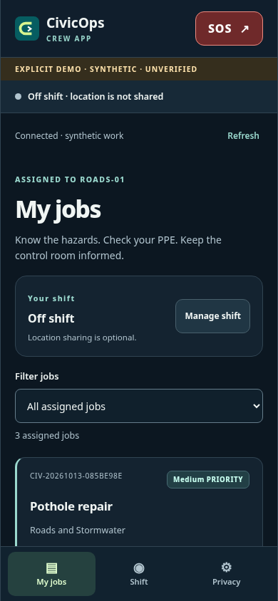</a></td><td><a href="docs/media/crew-consent.png">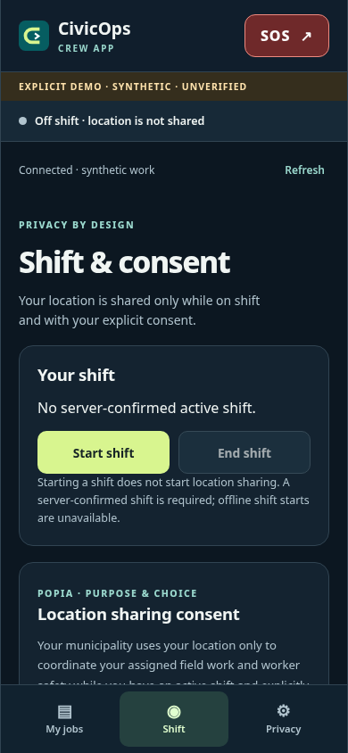</a></td></tr></table>

*Actual PWA captures with synthetic data; these are browser screens, not Android device captures.*

The native Kotlin/Compose app is under [apps/android-crew](apps/android-crew/). [Crew features, privacy and municipal deployment](docs/CREW_APP.md) · [Pinned Android build and measured limits](docs/ANDROID_BUILD.md). Pairing credentials are expiring, revocable and scoped to crew work. **SOS records a municipal control-room alert after deliberate confirmation. It does not call 10111, 10177 or 112, and it does not dispatch responders.** Real devices/MDM, municipal SSO, privacy notices and operating acceptance remain owner-pending.

## Crew, skills and the future training layer

The [versioned catalogue](products/civicops/catalog/work-orders.v1.json) supplies stable work-order codes, departments, hazards, skills/levels, certificates, PPE, typical procedure steps and SLA targets. Intake, Open311 service codes, validated model suggestions and dispatcher overrides share it. Overrides are audited and require renewed review and assignment.

Synthetic workers and crews persist across restarts. Eligibility checks department, availability, required skills and certificate issue/expiry dates. `CIVICOPS_CERT_POLICY=warn|block` controls certificate gaps: demo defaults to warn, other modes to block. Skill and availability gaps block assignment. The dashboard explains each outcome and shows each worker’s qualification evidence.

A separate scoped API at `/api/v1/training` exposes catalogue/version/ETag and worker qualifications, accepts idempotent training completions and controlled simulation certificate grants, and emits `training.completed` / `certification.granted` SSE events. Training tokens cannot access incidents. A passing record does not by itself grant a certificate; a trusted client must attest supervisor sign-off, and external certificates cannot be auto-granted. No VR, 3D or WebXR code is included. The future IWSDK/WebXR layer belongs under `layers/training`.

[Extension contract and authentication](docs/EXTENSIONS.md) · [JSON schemas](docs/schemas/) · [Layer boundary](layers/README.md).

## Outcomes and evidence

`/api/metrics` computes milestone medians from the audit trail: report → triage, approval, assignment and resolution. It also counts AI/fallback intake decisions, duplicate candidates and the share entering through web/Open311/chat. Unfinished milestones have no sample; empty metrics are null. Digital intake share is a proxy for avoiding a phone queue, not a measured reduction in queue wait. The dashboard labels the demo **synthetic data**. No response-time savings, adoption, cost reduction or institutional impact is claimed.

Every agent run records model/provider, confidence, rationale, latency and fallback. `/api/ai/status` supplies runtime decision latency; an operator’s AMD label does not attest hardware. The benchmark fetches the production triage schema and measures 15 synthetic patterns:

```bash
python3 scripts/amd_benchmark.py --civicops-url http://localhost:5080 --repetitions 3
```

[AMD setup and measurement limits](docs/AMD.md) · [MI300X deployment and benchmarking guide](docs/operations/AMD_VLLM.md) · [Retained ROCm bootstrap](deploy/amd/README.md). Actual AMD latency, throughput and accuracy remain unmeasured.

## Integration setup

ElevenLabs ships two agents, five authenticated server tools, English/Afrikaans presets and synthetic knowledge as code. Private voice/text fetches an ephemeral signed URL or WebRTC token from the backend, then starts the pinned official browser client only when configured and the resident clicks Start. Public agents use the widget; unconfigured/demo sessions use simulated chat. Live microphone, network and account behavior remain owner validation.

The resident desk externalizes English, Afrikaans and isiZulu UI strings, privacy notices, deterministic status messages and simulated chat. Its accessible language switcher updates page `lang`; staff strings have English keys ready for translation. Afrikaans/isiZulu are machine-drafted and need native-speaker and municipal notice review before production. The pinned ElevenLabs conversational preset supports English/Afrikaans; in live configuration selecting isiZulu keeps the form available and explains that voice support is pending. Simulated en/af/zu chat remains available in demo/unconfigured mode. [Accessibility evidence and manual checklist](docs/ACCESSIBILITY.md).

```bash
dotnet run --project products/civicops -- elevenlabs provision
dotnet run --project products/civicops -- elevenlabs provision --check
```

The first command is a redacted dry run with no API calls. The `--check` commands are explicit read-only provider checks and require configured non-demo credentials; they never run at startup. Owner-authorized `--apply` provisions ElevenLabs assets.

[ElevenLabs owner checklist](docs/ELEVENLABS_SETUP.md) · [Optional ticketing outbox](docs/ZENDESK_SETUP.md) · [Dispatcher readiness checklist](products/civicops/docs/api.md) · [Blank full environment inventory](.env.example).

## Runtime boundaries

Staff sessions and named bootstrap dispatcher token hashes resolve audit identity on the server. Training clients and service accounts use scoped tokens and separate quotas. The live role matrix and municipality isolation are described in [RBAC.md](docs/RBAC.md). Resident lookups omit descriptions, contacts, transcripts and internal actors. The service worker caches the interface only. Danger language floors urgency and requires review; locations are unverified and catalogue targets are not arrival promises. CivicOps is not an emergency service.

Choose `CIVICOPS_STORAGE=file|postgres`; file is the zero-configuration default. One process owns each file `CIVICOPS_DATA_DIR`; a second process fails closed. File snapshots use flush plus atomic replacement and verify chained state hashes; directory fsync is not provided. PostgreSQL uses pinned Npgsql, embedded versioned SQL migrations under an advisory lock, fresh authoritative reads and transactions for case/contact/audit/delivery-intent writes. Every municipal durable store uses the same backend, including identity, workforce, training, consent/DSAR and provider receipts/artifacts. A database-wide write lock preserves optimistic versions across instances; it favours correctness over high write throughput. [Storage and migration guide](docs/operations/STORAGE.md).

The production image uses a digest-pinned SDK build stage and chiseled ASP.NET runtime, UID 1654, a shell-free readiness helper and writable data/temp mounts compatible with a read-only root. PostgreSQL Compose, optional OTLP/ROCm profiles and a strict-validated Helm chart include probes, TLS ingress, explicit proxy trust, resources, security contexts, migration hook, PDB, NetworkPolicy and optional collector ServiceMonitor. Helm rejects replica/HPA settings above one and uses Recreate; the owner must also prevent manual scaling or a second active release. SSE, sessions and quotas remain local, so overlapping upgrades and multi-node fan-out are pending. Hosted PostgreSQL outbox polling uses advisory leadership; row claims remain the delivery fence. [Deployment, scaling and rollback](docs/operations/DEPLOYMENT.md) · [Bounded shared-VM load evidence](docs/operations/LOAD_TEST_RESULTS.md). Container/cluster execution remains owner-pending.

`CIVICOPS_RETENTION_DAYS` enables an hourly purge of closed-case snapshots and separate optional contacts whose closing milestone is older than that many days. `CIVICOPS_PII_RETENTION_DAYS` independently removes closed-case contacts with value-free audit tombstones. Pending/dead-letter deliveries protect cases, and hashed retired submission keys prevent recreation on retry. Audit and integration artifacts are retained, so this is **not full PII deletion**. Training certificate intents recover across interrupted projection writes. [Checksummed backup/restore and tested recovery](docs/operations/BACKUP_RESTORE.md) support both backends and optional age encryption. [Signed audit exports](docs/operations/AUDIT_EXPORT.md) provide JSONL, an HMAC manifest, offline verification and exclusive local output; cloud object locking and external anchoring remain deployment work.

`/health/live` and `/health/ready` distinguish process/storage readiness from degraded simulated, unverified or failed providers; `/healthz` remains compatible. JSON logs carry correlation/trace IDs and reuse the PII/secret redactor. OpenTelemetry traces, metrics and logs support off/console modes and standard `OTEL_*` OTLP settings. Bounded provider circuit breakers preserve deterministic intake and queued delivery when dependencies fail. [Signals and dashboard examples](docs/operations/OBSERVABILITY.md) · [Proposed SLOs and error budgets](docs/operations/SLO.md). Collector/cloud monitoring, production backup scheduling/PITR, distributed sessions/quotas, verified resident identity, full privacy erasure and provider OAuth refresh remain owner work before a resident pilot. Staff identity and tenant isolation are implemented and tested locally; real municipal issuer setup and ingress hardening still require owner validation.

Production intake requires explicit acceptance of the versioned purpose notice; contact details are optional, stored separately and consented independently. The admin privacy panel records a request, identity-verification notes and an audited JSON access export, correction or local anonymisation. Backend model input/output, new audit detail and application logs redact detectable PII; direct provider speech reaches ElevenLabs before backend redaction. Set the Information Officer contact and approve the municipal processing basis before any resident pilot. [POPIA mapping and limits](docs/privacy/POPIA.md) · [DPIA template](docs/privacy/DPIA_TEMPLATE.md).

Strict nonce CSP, conditional pinned voice bundles, HTTPS HSTS, browser CSRF, bounded Unicode/JSON/headers, tenant/principal/IP quotas and env/mounted-file secret sources are implemented and tested. The [259-requirement ASVS review](docs/security/ASVS_L2.md) records gaps; [STRIDE threat model](docs/security/THREAT_MODEL.md), [disclosure policy](SECURITY.md), [secret sources](docs/security/SECRETS.md) and [security CI/SBOM](docs/security/CI_SECURITY.md) distinguish application evidence from owner deployment work.

[Architecture](docs/ARCHITECTURE.md) · [API documentation](products/civicops/docs/api.md) · [Reviewed OpenAPI snapshot and sync/lint workflow](docs/api/README.md) · [Generated OpenAPI](http://localhost:5080/openapi.json) · [Security](SECURITY.md).

## Verification

```bash
dotnet build -c Release
dotnet test -c Release
./scripts/smoke_lifecycle.sh
./scripts/smoke_e2e.sh
./scripts/smoke_browser.sh
./scripts/smoke_security_privacy.sh
./scripts/smoke_widget_csp.sh
./scripts/smoke_restore.sh
./scripts/smoke_audit_export.sh
./scripts/smoke_telemetry.sh
./scripts/smoke_map.sh
./scripts/with_ephemeral_pg.sh dotnet test -c Release
./scripts/security_dependencies.sh
./scripts/validate_deployment.sh
./scripts/lint_openapi.sh --install
./scripts/loadtest.sh
python3 scripts/check_docs.py
gitleaks detect --source . --log-opts="--all" --redact
gitleaks dir . --redact
```

Browser QA uses existing Chrome, pinned Playwright and axe-core; select them with `CIVICOPS_CHROME_PATH`, `CIVICOPS_PLAYWRIGHT_MODULE` and optional `CIVICOPS_AXE_CORE_PATH`. Axe is a verification dependency under the temporary tools directory, with no runtime browser bundle. QA blocks non-local requests, tests private session orchestration with an offline client double, and scans resident/control/admin views in both themes and narrow layouts. Screenshots go to `$TMPDIR/browser-smoke` by default, keeping checked-in media unchanged. Regenerate the affected admin, control-room and timeline captures explicitly (other captures stay unchanged):

```bash
CIVICOPS_UPDATE_MEDIA=1 ./scripts/smoke_browser.sh
CIVICOPS_UPDATE_MEDIA=1 ./scripts/smoke_map.sh
```

CI uses the default temporary screenshot destination and pinned Node 24 Actions on Ubuntu 24.04. The full build/browser/smoke job has a thirty-five-minute limit; security and deployment-validation jobs have five minutes and the PostgreSQL contract/recovery job has twenty. These bounded budgets accommodate the expanded suite on small runners. It includes Release warnings as errors, tests, HTTP/recovery/audit/telemetry smokes, map and existing axe/browser smokes when Chrome exists (clean skip otherwise), hadolint, Helm/strict kubeconform, audited Spectral and pinned gitleaks 8.30.1 with a committed checksum. CodeQL retains SARIF and fails on error findings; code-scanning upload and dependency review remain owner opt-ins. Prior CI runs were checked read-only; CI for these local commits awaits the driver's push.

| Evidence | Current local result |
|---|---|
| Release automated tests | **1,603 default / 1,721 PostgreSQL tests**, 0 failed/skipped; [round-11 verification](docs/VERIFICATION.md) records the disposable-cluster command |
| Chrome desktop/mobile checks | **169 passed**, including **15 axe scans with zero A/AA violations**, light/dark/320px checks and resident language flows; the actual pinned widget adds **8** isolated rendering checks |
| Live map browser checks | **65 passed / 4 axe scans**, zero unexcepted violations; dense geographic-pin exceptions retain raw reports and measured equivalent controls; [accessibility evidence](docs/ACCESSIBILITY.md) |
| HTTP lifecycle and channel smokes | Lifecycle passed with 10 audited entries; channel smoke passed with **99 checks / 133 verified audit entries / 6 axe scans** |
| Security/privacy HTTP | **25 passed**: headers, consent, CSRF, identity-verification notes, access export, local anonymisation and audit |
| Recovery / signed audit / OTLP | Both backends restored **2 cases / 12 verified audit entries**, including age encryption; **3 signed exports** verified/tamper rejected; actual loopback traces/metrics/logs received |
| Security CI/inventory | NuGet and two reviewed map packages advisory-clean; **67-component CycloneDX SBOM**, all previous components retained; CodeQL/dependency review configured and new CI execution pending |
| Bounded synthetic load | All **8 scenario threshold sets / 652 checks** passed across file/PostgreSQL, with **202 verified audit entries each**; shared VM evidence, no production capacity claim |
| API contracts | **114 paths / 124 operations / 155 schemas**; mapped-route and committed-snapshot tests, usable examples and audited Spectral (**0 findings**) |
| Resident languages | English/Afrikaans/isiZulu resources and chosen-language consent/status; machine-drafted af/zu require native review; live isiZulu voice pending |
| Provider contracts | Round-2 saved/current docs comparison, fake transport and golden dry-run tests |
| Live providers | ElevenLabs and Gemini live on the demo; AMD unverified; ticketing outbox optional and unused |
| Deployment assets | Hadolint; **3 Helm lints / 4 strict Kubernetes renders / 8 unsafe configurations rejected**; Compose semantic checks and **5 health-helper checks**; Docker/cluster execution pending |

## Submission and licence

[Submission draft](docs/SUBMISSION.md) discloses the pre-event work and the 12–18 October build window. Live demo: https://civicops.culltron.app.

[MIT](LICENSE). Provider services and model weights retain their own terms.
