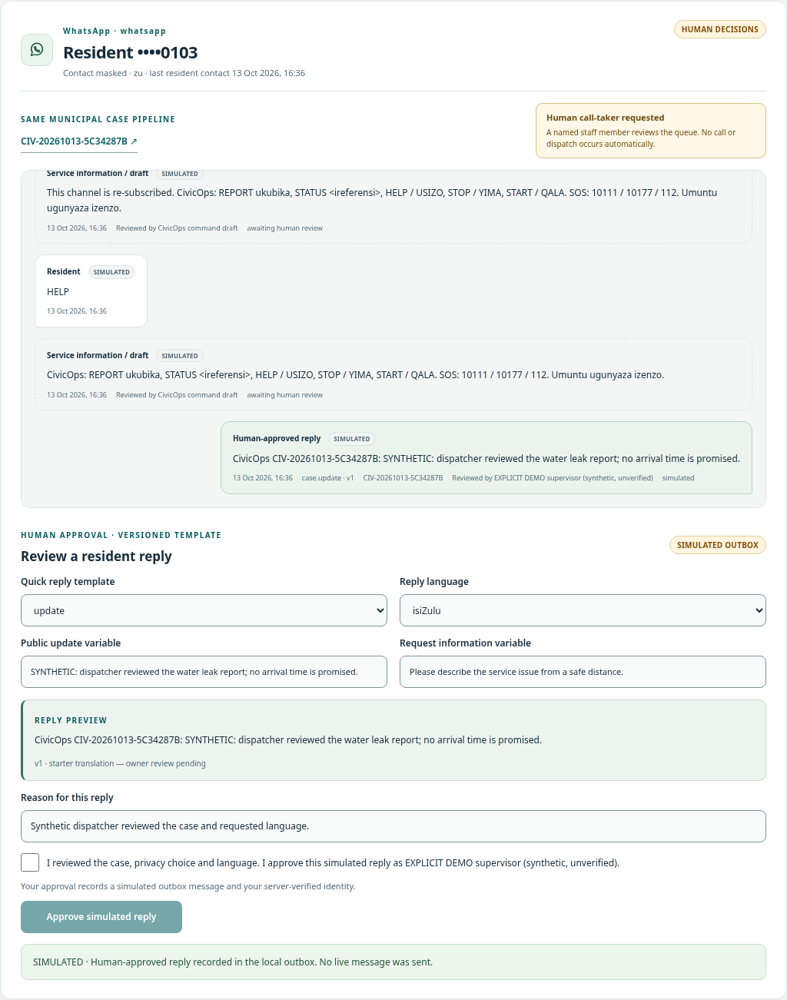
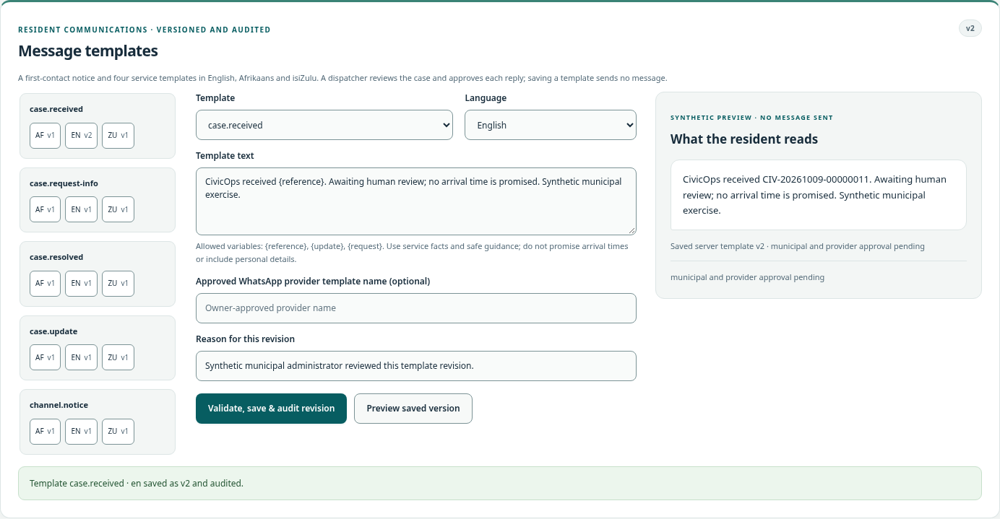

# Municipal voice, SMS and WhatsApp intake

CivicOps accepts normalized voice, SMS and WhatsApp messages through the same `IncidentCoordinator` as web/Open311. Deduplication, bounded triage, optional ward geofencing and mandatory human approval remain unchanged. The **Inbox** combines channel threads, linked cases, call-taker/callback flags, private timelines, versioned templates and named human sends. **Integrations** shows simulated, configured or disabled status and channel counters.

**EXPLICIT DEMO uses synthetic signed fixtures and simulated sends. No provider call, SMS, WhatsApp message, email or media download was performed for this implementation.** Configured transports are implemented and tested with fake handlers; municipal accounts, routing, provider delivery/playback, translation approval and operating acceptance remain owner-pending. SOS is an information stub: **10111 / 10177 / 112**, with no responder notification or dispatch.





## Zero-configuration exercise

```bash
CIVICOPS_DEMO_MODE=true dotnet run --project products/civicops --urls http://localhost:5080
./scripts/smoke_channels.sh
```

Open **Inbox → Load synthetic conversations**. Synthetic SMS, WhatsApp and voice records enter the actual case pipeline; the voice example includes a callback and human handoff. Existing web/Open311 and legacy ElevenLabs cases are synchronized into the inbox when the inbox list is read. Reports without an addressable/consented contact retain an explicitly unverified web/call identity; CivicOps does not invent a resident identity or phone number. No browser/provider SDK or media URL is loaded by the inbox.

## Configuration and readiness

Both [.env.example](../.env.example) and the [product inventory](../products/civicops/.env.example) contain blank placeholders only. Export values or use mounted files; do not create a filled environment file in this repository. Secret variables below also support an absolute `_FILE` path through the existing secret provider.

| Setting | Meaning |
|---|---|
| `CIVICOPS_CHANNEL_MODE` | `simulated`, `disabled` or `configured`; blank selects simulated behavior. Explicit demo always forces simulation and disables native ingress/transport. |
| `CIVICOPS_CHANNEL_ENCRYPTION_KEY` | Owner-managed base64 encoding of exactly 32 random bytes; AES-GCM contact encryption and separately bound keyed contact/content hashes. Required outside demo. Back up securely; key rotation needs a deliberate migration. |
| `CIVICOPS_CHANNEL_INGRESS_SECRET` | Shared key for the trusted provider-authenticating relay envelope. |
| `CIVICOPS_CHANNEL_WEBHOOK_BASE_URL` | Exact public HTTPS origin, optionally including `/m/{slug}`; no credentials/query/fragment. Native Twilio signatures use this configured URL, never caller Host. |
| `CIVICOPS_CHANNEL_SEND_ENABLED` | Only explicit `true` with configured non-demo mode enables one named human-approved transport attempt. Blank disables external sends. |
| `CIVICOPS_CHANNEL_RETENTION_DAYS` | 1–30 days, default 30, for contacts, conversations, messages and value-bearing drafts. |
| `CIVICOPS_CHANNEL_RELAY_PORT`, `CIVICOPS_CHANNEL_RELAY_TARGET` | Loopback listener port, default 5092; literal loopback HTTP CivicOps root URL, default `http://127.0.0.1:5080`. No DNS/public destination or redirects. |
| `CIVICOPS_SIP_CALLBACK_SECRET` | Owner PBX gateway custom `X-CivicOps-Sip-Token`, required before the gateway envelope is accepted. |
| `CIVICOPS_TWILIO_AUTH_TOKEN` | Native Twilio signature secret/outbound authentication. |
| `CIVICOPS_TWILIO_ACCOUNT_SID`, `CIVICOPS_TWILIO_FROM_NUMBER` | Expected account and municipal E.164 receiver/sender; callbacks must match both. |
| `CIVICOPS_CLICKATELL_API_KEY` | Outbound SMS authorization. |
| `CIVICOPS_CLICKATELL_CALLBACK_SECRET`, `CIVICOPS_CLICKATELL_FROM_NUMBER` | Configured custom callback security header and municipal receiver. |
| `CIVICOPS_WHATSAPP_APP_SECRET` | Native Meta raw-body HMAC secret. |
| `CIVICOPS_WHATSAPP_VERIFY_TOKEN` | Constant-time webhook challenge verification token. |
| `CIVICOPS_WHATSAPP_ACCESS_TOKEN`, `CIVICOPS_WHATSAPP_PHONE_NUMBER_ID` | Outbound bearer and expected business receiver ID; callbacks must match the receiver. |
| `CIVICOPS_ELEVENLABS_INBOUND_SIP_URI` | Optional pre-provisioned `sip:` agent destination; blank selects IVR. Account/PBX provisioning and live transfer acceptance are owner work. |

ElevenLabs also uses the existing `ELEVENLABS_WEBHOOK_SECRET`, `ELEVENLABS_API_KEY`, `ELEVENLABS_AGENT_ID`, `ELEVENLABS_CALLBACK_AGENT_ID`, `ELEVENLABS_AGENT_PHONE_NUMBER_ID` and `ELEVENLABS_PHONE_PROVIDER` settings. [ElevenLabs setup](ELEVENLABS_SETUP.md) records existing tool, session and callback contracts. Unconfigured providers remain disabled/simulated rather than claiming a connection.

Demo creates a random local synthetic contact key in the selected data backend, alongside synthetic state. This enables repeatable encrypted storage/restarts; it is **not production key custody**. Non-demo requires the separate owner key. Protect the data volume/database/backups, mount secrets with restricted permissions, and keep one active app instance as required by [deployment](operations/DEPLOYMENT.md).

## Webhook URLs and authentication

Use the following application routes, with the same municipality prefix as the configured public base:

| Provider | Native route | Provider-native authentication |
|---|---|---|
| Twilio SMS | `POST /api/v1/channels/webhooks/twilio-sms` | `X-Twilio-Signature`: base64 HMAC-SHA1 of exact configured URL plus **all** sorted decoded form parameters. The legacy algorithm is required by Twilio; the relay layer adds SHA-256/freshness. |
| Twilio voice | `POST /api/v1/channels/webhooks/twilio-voice` | Same native scheme; CallSid plus turn content supplies stable message IDs. Response is TwiML. |
| Clickatell SMS | `POST /api/v1/channels/webhooks/clickatell` | Constant-time `X-CivicOps-Clickatell-Token`, configured as a Clickatell custom security header. There is no invented Clickatell native body-HMAC claim. |
| WhatsApp Cloud | `POST /api/v1/channels/webhooks/whatsapp` | `X-Hub-Signature-256: sha256=<hex>`, HMAC-SHA256 of exact UTF-8 body with the Meta app secret. |
| WhatsApp verification | `GET /api/v1/channels/webhooks/whatsapp` | `hub.mode=subscribe`, matching `hub.verify_token`, bounded numeric `hub.challenge`; returns plain challenge text. |
| ElevenLabs post-call | `POST /api/v1/channels/webhooks/elevenlabs` | `ElevenLabs-Signature: t=<seconds>,v0=<hex>`, HMAC-SHA256 of `timestamp.body`; native timestamp window also verified. |
| SIP/PBX event gateway | `POST /api/v1/channels/webhooks/sip` | Constant-time `X-CivicOps-Sip-Token`, provisioned on the municipal PBX gateway, plus the trusted relay envelope; strict structured-event JSON, never RTP/audio. |

Native POSTs additionally require a **CivicOps trusted-relay contract**, not a header a vendor magically supplies:

```text
X-CivicOps-Timestamp: Unix seconds
X-CivicOps-Nonce: fresh 16–128 character ASCII nonce
X-CivicOps-Signature: sha256=<hex HMAC-SHA256>
signed bytes = timestamp + "." + nonce + "." + provider + "." +
               configuredPublicWebhookUrl + "." + exactUtf8Body
```

The authenticated relay must verify the native provider first, strip caller-supplied CivicOps headers, preserve original bytes and native signature, then sign this envelope. Application verification uses constant-time comparison, at most 300 seconds age/30 seconds future skew, durable tenant/provider nonce replay protection and the normal municipal/IP intake limiter. Twilio/Meta native signatures lack a signed delivery timestamp; Clickatell's custom header is static. Direct unauthenticated relay stamping would defeat freshness and is prohibited.

Native receiver/account checks prevent one configured number/account from injecting another's reports. Batch callbacks claim one nonce; each message independently deduplicates by provider message ID and keyed normalized content. Received-at transport time and changing batch wrappers cannot duplicate an otherwise identical message. Reusing an ID for different sender/text/location/consent conflicts. Invalid signatures, stale envelopes, duplicate nonces and unknown SIP/simulator properties do not create cases. JSON/form bodies are bounded to 256 KiB; normalized text to 4,000 characters, media metadata to ten bounded IDs. Native Twilio forms are the only non-JSON exception to the normal mutation media policy.

For synthetic fixtures only, use `POST /api/v1/channels/simulated/{provider}` as an authenticated demo dispatcher. Its same HMAC scheme uses the known **synthetic** signing key `synthetic-channel-signing-key` and binds the municipality ID instead of a public webhook URL. This route is absent outside explicit demo; a synthetic signature never grants native provider access.

Primary protocol references: [Twilio signature validation](https://www.twilio.com/docs/usage/security), [Clickatell SMS callbacks](https://help.clickatell.com/developers-api-reference/sms-client-callbacks.md), [Clickatell custom security headers](https://help.clickatell.com/developers-documentation/custom-security-headers-for-webhook-callbacks.md), [ElevenLabs post-call webhooks](https://elevenlabs.io/docs/eleven-agents/workflows/post-call-webhooks), [Meta business messaging documentation](https://developers.facebook.com/documentation/business-messaging/whatsapp/). These are provider contracts, not evidence of a live municipal deployment.

## Run the provider-authenticating relay

The implemented [Python standard-library relay](../scripts/channel_relay.py) authenticates each native provider before creating a fresh gateway envelope. Configure the same trusted `CIVICOPS_CHANNEL_WEBHOOK_BASE_URL`, ingress secret and provider receiver/secret settings on the relay and application. The application additionally needs non-demo configured mode and its owner contact-encryption key. Each absent provider secret disables that provider; missing global relay configuration fails closed.

```bash
python3 -B scripts/channel_relay.py
python3 -B scripts/test_channel_relay.py
```

The relay listens only on loopback (default `127.0.0.1:5092`); owner HTTPS ingress must forward the exact native paths, including an optional `/m/<slug>` prefix, to that listener. Its target is a literal loopback HTTP address and root path; the relay appends the configured municipal path. It never follows redirects or resolves a public target. Incoming CivicOps authentication headers, cookies, authorization and Host are discarded. Native signature headers are preserved only after verification. Original body bytes are bounded and strict UTF-8; raw bodies and contact values are never logged. Threads, socket time and connection lifetime are bounded. Local tests use loopback fake servers; proxy TLS, process supervision, public network limits and privacy-safe ingress logging remain owner deployment work.

All secret settings support absolute mounted `_FILE` paths, with mounted values taking precedence, bounded UTF-8 content and trailing CR/LF removal. Twilio/Meta lack native delivery freshness; the relay proves recent authenticated forwarding, not the time the vendor originally signed an event. Provider message-ID/content receipts prevent duplicate case processing. Native ElevenLabs timestamps have an additional 1,800-second age / 30-second future bound.

## Voice and case routing

Twilio voice either returns the bounded IVR report/status/human/callback/SOS menu or routes to an explicitly configured ElevenLabs SIP destination. The response supplies the processing notice; a resident must explicitly say YES before a report is processed. CivicOps records that it supplied the IVR response, **not that provider playback was verified**. Speech results and ElevenLabs structured summaries enter the same case pipeline, with no stored audio, voiceprint or identification. Withheld callers use an unaddressable call identity and cannot receive an outbound callback.

Human handoff, initiation failures, unsupported audio/video and callback requests enter the visible call-taker queue. A callback request places no call. Voice sends require a resident callback request, accepted processing notice for case messages, an addressable contact and named human approval. Configured isiZulu callbacks remain disabled pending provider/native-language acceptance; demo supports synthetic en/af/zu. SIP outbound/PBX staffing/actual telephony failover and agency dispatch integrations require owner engineering/operational acceptance. The existing legacy ElevenLabs callback endpoint remains available and also consults the channel suppression list.

WhatsApp supports text, supported interactive/button replies, location, and bounded image/document **IDs only**. Audio/video produces a human-queue notice without retaining IDs/bytes. No media URL is fetched. A volunteered location is validated, purpose-gated and geofenced; a native location follow-up enriches only an unapproved, unassigned PendingApproval draft. For an approved/assigned case, it creates a separate case awaiting human review and preserves the operational destination, with an under-lock approval-race check. No worker tracking, camera frames, biometric fields, individual scoring or automatic dispatch are accepted through this interface.

## Consent, commands and templates

First contact creates a privacy-notice draft. SMS/WhatsApp processing waits for a named human to provide that notice and an explicit YES/JA/YEBO response; external notice delivery/playback is unverified. Provider-collected current-version explicit consent may also accompany a verified structured voice report. Synthetic fixture consent remains explicitly unverified exercise data. Contact preferences and optional location stay separate from processing purpose.

| Command | Effect |
|---|---|
| `STOP`, `UNSUBSCRIBE`, af `HOU OP` / `STAAK` / `TEKEN UIT`, zu `YIMA` / `MISA` / `YEKA` / `UNGANGITHUMELI` | Persistent suppression for this municipality/number/channel, including another SMS provider. |
| `STOPALL` | Suppresses the number across voice/SMS/WhatsApp. |
| `START`, af `BEGIN` / `HERVAT`, zu `QALA` | Re-subscribes the current channel; other explicitly suppressed channels stay suppressed. |
| `HELP`, `HULP`, `USIZO` | Command/menu draft for human review. |
| `REPORT`, `RAPPORTEER`, `BIKA` | Prompts for the problem/area; `REPORT <description>` enters the processing gate. |
| `STATUS <ref>` | Minimal public update only for a case linked to this conversation; bare STATUS prompts for a reference. |
| `HUMAN`, `CALLBACK` | Human call-taker/callback queue; no call or dispatch. |
| `SOS` | Emergency information stub, with **10111 / 10177 / 112**; no notification or automated safety action. |

Command/receipt/notice replies are drafts; CivicOps does not automatically send messages from agent or intake code. Human sends require authenticated dispatch permission, current conversation/template versions, reason and operation ID. Suppression is checked before intent/request construction. Only a first-contact notice may be provided before processing consent. Resolved templates require an actually resolved/closed linked case.

`case.received`, `case.update`, `case.resolved`, `case.request-info` and `channel.notice` have en/af/zu starter versions. Admins preview, edit and create an audited new version; only `{reference}`, `{update}`, `{request}` variables are allowed. Templates/af/zu notices need municipal/native-speaker review before production. Edits use expected versions and cannot silently replace a previewed human send.

WhatsApp free-text/interactive replies require an open **strictly less than 24-hour** window from the native signed resident message timestamp. Delayed delivery cannot reopen it. Human notice replies can include Report a problem / Check my case / SOS info buttons in that window. Outside it, the adapter requires an owner-registered approved provider template name; parameters are ordered by placeholder key, and registration must match that order and language. Configured approved-template names never establish provider approval by themselves. Provider rejects/ambiguous outcomes are visible; there is no automatic retry or fallback to unapproved free text.

Send intent is durable before one HTTP attempt. Lost responses/restarts return the same operation receipt; pending or ambiguous attempts require human reconciliation rather than another send. A provider 2xx is **accepted-unverified**, not proof of delivery. Simulation persists a labelled outbox message and never builds a live request.

## Data, audit and limits

Transient From/To values are encrypted before journal persistence. Number hashes are keyed, tenant-bound and shared only across that municipality's channels; contact labels show at most four terminal digits. Messages contain redacted text/summary and optional opaque media IDs, never audio/video/raw provider bodies or media URLs. Timelines and cases require staff permissions; crew/resident callers cannot read the inbox. Cookie writes use CSRF. Access events contain actor/tenant/route/count metadata, not message/location/contact values.

Conversations/messages/contacts and pending report/send text expire at the configured 1–30-day bound, with hourly automatic purge; reads hide expired conversation/message data. Pending drafts expire independently even if HELP keeps a thread active. Provider receipt metadata lasts 90 days; suppression hashes intentionally survive conversation purge/restart until START, so retention cannot silently re-enable sending. Minimal send tombstones prevent repeated ambiguous sends without retaining rendered text. Template history, aggregate counters and value-free audit remain. Historical backups, exports, old file blocks, existing case/audit stores and provider-held records require the broader municipal retention/erasure schedule; this is not full erasure. [POPIA limits](privacy/POPIA.md) and [Responsible AI guards](RESPONSIBLE_AI.md) apply.

Local file storage remains single-process. PostgreSQL shares transactional journal/incident/audit state. Prepared intake is durable before reasoning, which runs outside journal/SQL locks; recovery uses the same case idempotency key. Independent journal integrity checks and mirrored municipal audit events detect accidental/tampered state; they do not defeat a host/database administrator rewriting all evidence. Channel nonce/message-ID receipts are durable; HTTP rate quotas, staff sessions and SSE remain process-local; one active app instance is required.

Inbox list currently returns up to 500 latest retained conversations; each timeline is bounded to 1,000 entries and a municipality to 5,000 channel conversations. Provider body/message limits and municipality/IP quotas are enforced before processing. Production capacity, high-volume pagination, distributed quotas and end-to-end delivery monitoring require municipal measurement/engineering.

## Costs and acceptance

No live spend, tariff, provider throughput or delivery measurement is claimed. Municipalities must budget carrier/SIP/phone-number/voice-minute and agent usage, SMS message segments/routes, and WhatsApp template/category usage under their selected contracts; verify current SA pricing, opt-in requirements, quality limits, approved templates, cross-border processing and outage handling directly with each provider. See [Twilio South Africa SMS pricing](https://www.twilio.com/en-us/sms/pricing/za), [Clickatell SMS API](https://help.clickatell.com/developers-api-reference/sms-api.md), [Meta WhatsApp pricing](https://developers.facebook.com/documentation/business-messaging/whatsapp/pricing/) and [ElevenLabs pricing](https://elevenlabs.io/pricing). No numeric cost or savings estimate is asserted.

Before resident data: approve processing basis/DPIA/Information Officer notices, provider operator/cross-border agreements, secret custody, TLS/proxy/relay ingress, real tenant receiver routing, template registrations/translation/accessibility, call-taker staffing/operating procedures and test-only provider delivery/playback/callback failover. No police, Fire/EMS/Disaster Management action or real emergency response is implemented here. [Readiness matrix](ENTERPRISE_READINESS.md) and [verification evidence](VERIFICATION.md) distinguish local tests from owner acceptance.
