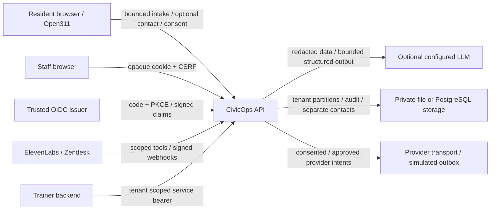

# CivicOps threat model

Reviewed 8 October 2026 against the synthetic file and PostgreSQL implementations and local recovery/export tests. This is an engineering review, not an independent penetration test or deployment approval. Revisit it for every new route, identity mapping, provider tool, data flow and hosting change. [ASVS review](ASVS_L2.md) tracks gaps; [privacy assessment](../privacy/POPIA.md) and [DPIA template](../privacy/DPIA_TEMPLATE.md) cover lawful processing. [Storage](../operations/STORAGE.md), [backup/restore](../operations/BACKUP_RESTORE.md) and [signed exports](../operations/AUDIT_EXPORT.md) distinguish local evidence from deployment responsibilities.

## Assets and boundaries

Protect municipality records and contact details, staff/session credentials, service/provider secrets, human approval authority, qualification evidence, audit history and service availability. Residents, browser scripts, model output and provider requests are untrusted. Municipal administrators are privileged within their municipality; host operators and database superusers can read or rewrite durable data and must be separately trusted.

The application trusts the transport IP, validated staff principal and configured municipality host/path. It does not trust forwarded headers, caller role labels, model instructions, body tenant identifiers or a case reference as proof of resident identity. Ingress, DNS, certificates, mounted-volume access and external providers are distinct operational boundaries.

## STRIDE review

S = spoofing; T = tampering; R = repudiation; I = information disclosure; D = denial of service; E = elevation of privilege. Each row identifies a concrete threat, implemented control and remaining risk.

| Component | STRIDE | Threat | Mitigation and evidence | Residual risk / owner action |
|---|---|---|---|---|
| Resident intake | S | Invented resident identity, location or municipality | Host/path tenant validation; caller identity remains explicitly unverified; `TenantContext`, `EnterpriseAccessMiddleware`, tenant endpoint tests | Verify location and resident identity before sensitive service decisions; public intake is intentionally open. |
| Resident intake | T | Extra fields, control characters, duplicate JSON or oversize narrative | Typed DTOs, centralized validation/body limits and bounded JSON depth; `RequestValidation`, `RequestHardening`, security input tests | New routes must retain the same controls; multilingual free text remains untrusted. |
| Resident intake | R | Disputed consent or repeated submission | Versioned consent record and audit; idempotency receipts; privacy and lifecycle tests | A recorded checkbox is not independent proof of the submitting person's identity. |
| Resident intake | I | Narrative/contact exposed through status, logs or model request | Minimal public projection; separate contacts; redaction before logging/model use; `IncidentView`, privacy tests | Free text can contain indirect identifiers that pattern matching misses. |
| Resident intake | D | Flooding, huge/chunked bodies or long Unicode strings | Municipality/IP quota and content/body/string bounds; foundation/security tests | In-process quotas reset on restart; distributed ingress quotas and monitoring remain owner work. |
| Resident intake | E | Submitting approval, role, crew or internal case state | Intake DTO never accepts staff decisions; permission matrix and workflow enforce human review; RBAC tests | A host operator or compromised privileged staff member remains trusted. |
| Voice agent tools | S | Stolen/shared tool credential or fabricated conversation | Tenant-bound service scopes; constant-time legacy secret checks; conversation binding; ElevenLabs endpoint and service-account tests | Rotate provider workspace secrets; verify live account restrictions. |
| Voice agent tools | T | Tool argument pollution or attaching to another conversation | Allowlisted tool names/fields; bounded arguments and original conversation binding; tool/tenant tests | Voice provider output can still be factually false and requires human review. |
| Voice agent tools | R | Unattributed repeated updates or ambiguous callback result | Audited updates, turn idempotency and durable receipts; callback tests | Provider delivery uncertainty needs human reconciliation; a voice is not verified identity. |
| Voice agent tools | I | Tools reveal unrelated cases or forward raw PII to reasoning | Explicit role/scope matrix, minimal resident views and model redaction; RBAC/AI/privacy tests | Reviewed provider contact delivery is a separate processing operation requiring contracts/consent. |
| Voice agent tools | D | Endless conversations, repeated turns or private session grants | Tenant/conversation/principal/IP partitioned limits and bounded provider responses; session/endpoint tests | Live provider spend caps and private resident grant policy need owner validation. |
| Voice agent tools | E | Agent assigns a crew or approves communications | Agent scopes allow recommendations/intake only; staff/supervisor decisions enforced server-side;  role matrix tests | Prompt policy alone is never an authorization boundary. |
| Webhooks | S | Forged ElevenLabs or Zendesk event | Raw-body HMAC, constant-time verification, timestamp freshness; signature/webhook tests | An attacker with the provider secret can forge valid events; protect/rotate secrets. |
| Webhooks | T | Body modified, duplicate/conflicting replay, foreign ticket/case | Signed exact bytes, bounded parsers, durable event markers and tenant binding; webhook/tenant tests | External provider identity and eventual consistency require live validation. |
| Webhooks | R | Claim delivery without durable evidence | Persisted receipts/outbox transitions and chained audit; persistence/outbox tests | Signed export checkpoints require protected historical keys and external retention; the live chain is not externally anchored. |
| Webhooks | I | Audio/transcript copied into public API or logs | Audio discarded; protected transcript attachments; generic transport failures and redaction; endpoint/privacy tests | Provider copies and historical backups need separate retention/deletion instructions. |
| Webhooks | D | Large bodies, replay storm or corrupt envelopes | Different explicit webhook limits, parser depth/freshness and rate limits; operational/input tests | Volumetric abuse must be absorbed at ingress; local replay files can grow. |
| Webhooks | E | Remote event performs arbitrary lifecycle transition | Known status mapping, loop guard and qualified workflow transitions; Zendesk workflow tests | Provider-side trigger permissions and administrator scope require review. |
| LLM / prompt injection | S | Model impersonates supervisor, provider or verified hardware | Recorded provider/model/fallback provenance and explicit simulation/unverified labels; AI pipeline tests | Operator labels cannot attest AMD hardware or inference quality. |
| LLM / prompt injection | T | Narrative overrides instructions or returns hostile JSON | Separate system/user messages; strict bounded schema and output validation; independent hazard floor; deterministic fallback; classifier/AI tests | Schema-valid false suggestions remain possible; benchmark and red-team configured model. |
| LLM / prompt injection | R | Hidden model decision or unclear fallback | Input hash, output, latency, rationale and fallback code in agent run/audit; AI/persistence tests | Reproducibility depends on model/version/hosting; no claim of explainability certification. |
| LLM / prompt injection | I | Model exfiltrates contact/IDs or returns PII in output | PII redaction before model input and logging; agents lack network/tool authority; privacy tests | Names/indirect identifiers are heuristic; model host operator and cross-border contracts require review. |
| LLM / prompt injection | D | Slow inference, retries or enormous model response | Shared timeout, two-attempt maximum, token/byte/depth bounds and fallback; AI tests | A reachable model can consume capacity; ingress/workload capacity needs deployment measurement. |
| LLM / prompt injection | E | Output triggers privileged tool, dispatch or training grant | Agents only recommend/draft; server validates catalogue and human decisions; workflow/training tests | Staff must review convincing but incorrect rationale. |
| Dispatcher UI | S | Session theft, demo impersonation or stale group membership | OIDC code+PKCE; opaque Secure/HttpOnly/Lax production cookie; demo-only labelled login; identity/OIDC tests | MFA is an issuer policy; SSO roles refresh at sign-in/expiry; demo must be disabled for pilot. |
| Dispatcher UI | T | Stored DOM XSS, clickjacking or CSRF writes | Context escaping, strict CSP without unsafe-inline, frame-ancestors and antiforgery header; browser/header/CSRF tests | Live third-party widget/SDK behavior under CSP remains owner validation. |
| Dispatcher UI | R | Action attributed to arbitrary caller label | Principal-derived actor and chained staff decisions; identity/persistence tests | Shared legacy dispatcher credentials weaken personal accountability. |
| Dispatcher UI | I | Another municipality or unassigned crew sees cases | Server-side municipality/resource/crew guards; privacy-filtered public views; RBAC/tenant tests | Browser screenshots and shoulder surfing require staff policy; process memory is privileged. |
| Dispatcher UI | D | Many streams, repeated polling or bulk exports | Authenticated tenant/principal quotas and bounded stream channels; stream/rate tests | Per-user concurrent connection caps and deployment-wide alerting remain partial. |
| Dispatcher UI | E | Auditor writes, crew reassigns or dispatcher approves critical hazard | Exhaustive method/route permission policy and supervisor/assignment checks; RBAC tests | Compromised administrator has broad municipal authority; step-up authentication is pending. |
| Training API | S | Untrusted client claims supervisor sign-off | Separate hashed tenant-bound credentials and explicit scopes; training/service tests | Supervisor attestation is trusted-client asserted, not separately verified identity. |
| Training API | T | Forged catalogue version, score, certification or replay | Shared versioned catalogue; bounded typed records; required idempotency; grant policy/recoverable intent; training/workforce tests | Evidence authenticity from external trainers remains their contractual responsibility. |
| Training API | R | Completion/certificate disappears or is granted twice | Independent audit/state hashes and recoverable certification projections; training recovery tests and local file/PostgreSQL restore drill | External audit anchoring, production recovery timing and municipal backup scheduling remain owner-pending. |
| Training API | I | Trainer retrieves incident data or another tenant's workforce | Training-only scopes and tenant store partition; RBAC/tenant/training tests | Qualification records can be personal data; owner must classify/minimize real worker identifiers. |
| Training API | D | Mass completions, grants or SSE consumption | Auth-first tenant/principal quota, bounded bodies/fields; training/input tests | Durable store growth requires operational storage quotas and workforce retention policy. |
| Training API | E | Passing exercise grants external or safety-critical credential | Only allowed simulation grants after passing record plus trusted supervisor attestation; qualification floor; training tests | Municipal accreditation and safety governance require owner approval. |
| Admin | S | Bootstrap token theft or administrator role-map error | Hashed one-time-issued tokens with expiry/revocation; explicit issuer mappings; admin/identity tests | Owner must protect bootstrap delivery, require issuer MFA and avoid routine legacy credentials. |
| Admin | T | Catalogue corruption, header injection or role/tenant rebinding | Allowlisted fields/roles/IDs; validated references, versioned revisions and chained mutations; admin/tenant/input tests | Privileged configuration is trusted; review changes and backups before deployment. |
| Admin | R | Denial of user, token or privacy-request mutation | Principal-derived actor, verification notes and metadata audit tombstones; admin/privacy tests | Local audit cannot defeat an attacker controlling the host filesystem. |
| Admin | I | Token, secret or exported resident data appears in readiness/logs | Tokens shown once/no-store, hashes in storage, config names/states only, generic secret errors; sentinel tests | DSR export is intentionally sensitive; verify identity and transfer through an approved channel. |
| Admin | D | Purge, token creation or catalogue churn exhausts storage | Admin-only routes, request quotas and bounded configuration; admin/security tests | Fleet-wide resource quotas, operational change approval and rollback rehearsal remain pending. |
| Admin | E | Administrator crosses municipality or DSR grants operational power | Tenant identity cannot be rebound; explicit admin and DSR policies; tenant/privacy tests | Host operator/global tenant directory duties need institutional separation and access review. |
| Storage | S | Second process or forged snapshot accepted | File process lease; PostgreSQL fresh reads and transactional versions; snapshot/audit verification; persistence/PostgreSQL tests | Host/database administrators can replace durable data; file mode remains single-process. |
| Storage | T | Concurrent writes, interrupted replacement or mismatched audit | File flush+atomic replace; PostgreSQL case/contact/audit/outbox transaction and audit projection guards; persistence/PostgreSQL tests | Database operations use a coarse advisory lock; provider calls are outside transactions. File directory fsync and external audit anchoring remain absent. |
| Storage | R | Local chain rewritten or suffix removed | Hash-chain verification, PostgreSQL projection tail/rewrite guards, signed HMAC exports with offline tamper checks and privacy tombstones; audit/export/PostgreSQL tests | Host/database and signing-key compromise can replace checkpoints; independent key custody and external immutable retention remain owner work. |
| Storage | I | Private contact/narrative, mounted secret or backup exposed | Separate contacts, retention/redaction, env/mounted secrets, restricted backup files and optional age encryption; privacy/secret/recovery tests | Production at-rest encryption, host/backup ACLs, recovery key custody/rotation and provider erasure are owner responsibilities. |
| Storage | D | Disk fills, corruption or purge erases pending work | Payload bounds, leases, protected undelivered/dead-letter retention and tested local file/PostgreSQL restore; operational/outbox/privacy/recovery tests | Storage quotas, production backup scheduling/off-site retention, PITR and measured municipal RPO/RTO remain owner-pending. |
| Storage | E | Filename/path traversal or secret mount becomes executable content | Server-generated record paths and validated tenant IDs; web root separate from runtime data; tenant/input tests | Container execution, secret-mount ACLs and network sandboxing were not run on this box. |

## Risk acceptance before a resident pilot

The municipality must assign an Information Officer/security contact, establish lawful purposes and retention, verify staff MFA and role mappings, approve processor/cross-border terms, validate production HTTPS and trusted proxy configuration, encrypt and permission storage/backups, rehearse recovery on its deployment, and arrange monitoring and incident response. PostgreSQL cross-instance transactions, signed local audit exports and file/PostgreSQL restore drills are implemented and locally tested. File mode remains single-process; PostgreSQL throughput under its coarse lock, process-local sessions/quotas, external delivery deduplication, cloud immutable retention and production RPO/RTO require owner validation. Live providers, deployed browser microphones/widgets, external audit anchoring and complete backup/provider erasure remain unverified or unimplemented as described in the ASVS and POPIA reviews. Keep demonstrations synthetic until those decisions are recorded.
